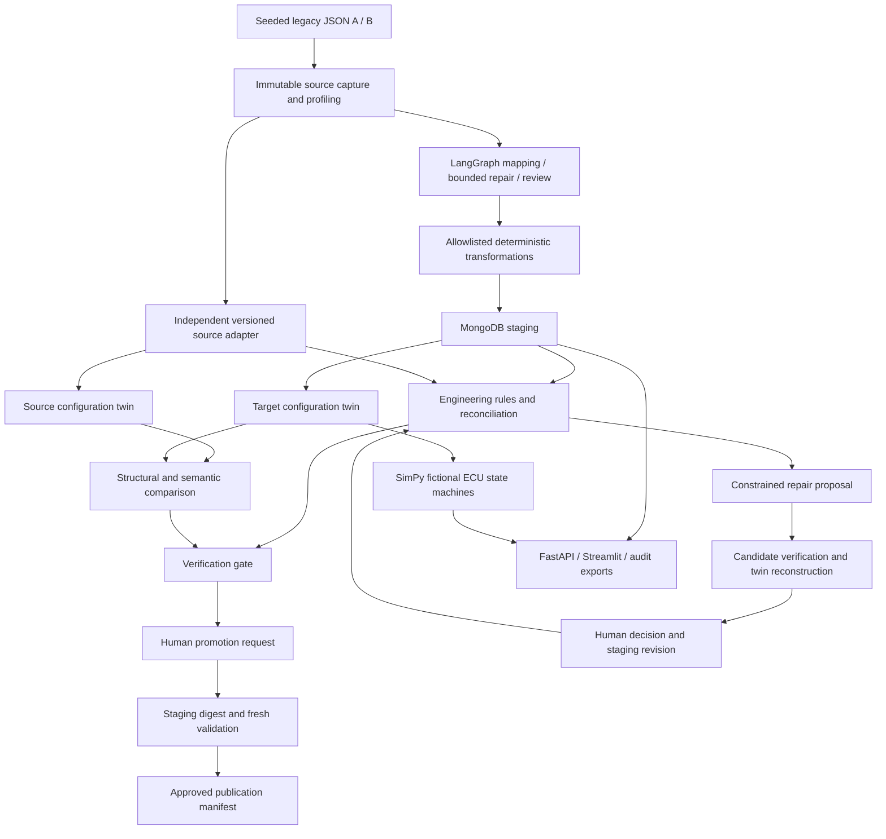

# AutoPLM Twin

**Agentic Automotive PLM Migration with Digital Twin-Based Engineering Verification**

A functioning Python engineering prototype for migrating **fictional, synthetic** vehicle engineering data. A record can satisfy a database schema while assigning incompatible software to an ECU. AutoPLM Twin preserves the source, stages transformations, checks engineering constraints, compares vehicle configuration twins, and exposes explicit human approval controls.

This project has no Teamcenter, Windchill, supplier, CAN hardware or production vehicle integration. Its signal simulation is a documented behavioral prototype, not validated vehicle physics.

## Phased delivery and approval

**Current status: Phase 1 and Phase 2 are complete. Phase 3 Engineering Change Impact Intelligence is in progress; Phase 3A Typed Engineering Dependency Graph, Phase 3B Mechanical Product Modelling, Phase 3C in-memory Isolated What-if Assessment and Phase 3D Interactive 2D Digital Vehicle are implemented and focused-tested.**

Phase 4A investigation, Phase 4B authoritative baseline/read-only API and Phase 4C persistent human engineering review are implemented and verified with offline/mocked providers. Phase 4E adds the Streamlit investigation/review workspace with mocked-HTTP acceptance coverage. Baseline/API and persistent-review paths also have real MongoDB coverage from prior phases. Live LLM behavior and live-browser acceptance of the new workspace remain unverified.

Phase 4D extends the same graph with bounded provider configuration and validated evidence synthesis. Implementation is verified offline/with mocked SDK responses; **live-provider verification remains pending because no model or API key was configured in the development session**.

Further implementation, commits and pushes require separate approval. Earlier publication approvals and build-review checkpoints are historical.

### Verified Phase 1 foundation

- **Engineering domain:** versioned schemas for ECU hardware/software, vehicle platforms/variants, multi-level BOMs and engineering changes; explicit lifecycle states, relationship identifiers, date validation and numeric software-version comparison.
- **Synthetic source data:** reproducible A/B legacy schemas, configurable dataset sizes, hardware/software compatibility constraints, separate canonical/mapping truth and fault labels, and preservation of surviving source identifiers in corrupted exports.
- **Mapping and transformation:** field profiling, an offline dictionary baseline, bounded LangGraph proposal/repair/review states, structured mapping validation and allowlisted transformations. Source reconciliation uses an independent adapter; no generated code is executed. Live LLM providers exist but remain unverified end-to-end.
- **Migration and persistence:** PyMongo source capture, staging, idempotent jobs, source provenance checks, record validation, audit history, controlled promotion and approved-publication integrity checks. Real MongoDB integration covers both legacy schemas, idempotency, promotion, indexes, corruption rejection and API/report reads.
- **Engineering safety and access:** deterministic BOM, compatibility, variant, dependency, interface, release and change checks; duplicate identity detection; FastAPI endpoints and JSON/CSV/HTML reports. Existing dashboard workspaces have unit coverage through Streamlit AppTest with a mocked-database backend; that does not establish a live dashboard-to-MongoDB acceptance result.

### Phase 2 Digital Twin Validation — completed

Completed and locally tested:

- Construct source and migrated configuration twins containing installed ECUs, hardware, software, topology and related engineering data.
- Canonicalize installed-ECU ordering without changing source records, so equivalent ordering produces the same fingerprint.
- Report genuine ECU differences at precise paths, including `/nodes/<ECU_ID>/hardware/hardware_revision` and `/nodes/<ECU_ID>/software/version`.
- Detect added and removed ECUs at `/nodes/<ECU_ID>`; report missing installed software as an engineering compatibility finding.
- Reject incompatible software even when source and target twins match; reject genuine twin differences independently of engineering findings.
- Revalidate before promotion, so a forged cached passing result, `verified` status and matching staging digest cannot bypass the safety gates.
- Accept a compatible software release when the expected source is updated before ingestion and all engineering/comparison checks pass. Target-only version drift remains rejected; no selective-delta approval policy is implemented.

Verification boundaries and next phase:

- Phase 2 is complete; further scenario hardening, including a migration-level missing-required-ECU regression, is optional follow-up work after checking existing coverage.
- The approved next direction is Engineering Change Impact Intelligence, beginning with the typed graph foundation documented below. Existing fictional SimPy scenarios remain a separate prototype; no new simulation capability or simulation-phase completion is claimed.
- The new service regressions use mongomock; the six real MongoDB integration checks are separate and do not cover every new scenario end-to-end. Live LLM behavior and production PLM/hardware integration remain unverified.
- Latest local evidence: **14 migration tests passed, 212 unit tests passed, 6 real MongoDB integration tests passed**, and Ruff passed on the modified migration test file. See Verification below for scope; no new benchmark or remote CI run is claimed.

The existing baseline already contains code for all eleven phases. The original build-review checkpoints below are preserved as historical context; they do not authorize new work or supersede the current focused milestone. Current implementation and verification qualifications are recorded in [PROJECT_PROGRESS.md](PROJECT_PROGRESS.md).

For each phase: inspect and implement its scope, run relevant checks, update this README with changes, actual results and blockers, then request your approval. Work on the next phase starts only after your explicit approval. This replaces the earlier autonomous execution workflow.

| Phase | Scope | Current delivery checkpoint |
|---|---|---|
| 1 | Engineering domain models | Reviewed and tested; continuation approved |
| 2 | Synthetic datasets and isolated ground truth | Completed and tested; continuation approved |
| 3 | Profiling, schema mapping and LangGraph agents | Completed and tested; awaiting approval to continue |
| 4 | MongoDB migration, provenance, staging and API | Next; awaiting approval to start |
| 5 | Deterministic engineering verification | Awaiting phased review |
| 6 | Configuration twins and behavioral simulation | Awaiting phased review |
| 7 | Agent-assisted repairs and human approval | Awaiting phased review |
| 8 | Streamlit engineering dashboard | Awaiting phased review |
| 9 | Fault injection and reproducible benchmarks | Awaiting phased review |
| 10 | Automated tests, lint, typing and CI | Awaiting phased review |
| 11 | Documentation and final acceptance report | Awaiting phased review |

### Phase 1 checkpoint: engineering domain models

- Existing implementation: `app/models.py` defines schema version 1.0 for ECU hardware, ECU software, vehicle platforms, vehicle variants, multi-level engineering BOMs and engineering changes, plus structured validation findings.
- Models preserve relationship identifiers, lifecycle/release states, revisions and dates. Software versions use semantic numeric comparison through `packaging.version.Version`; masses and BOM quantities reject nonfinite values, and quantities must be positive.
- Verification at this checkpoint: **4 tests passed** covering software-version validation and rejection of NaN/infinite hardware masses, source masses and BOM quantities. Earlier full-suite evidence remains available separately; this checkpoint did not rerun the entire suite.
- No code changes were needed for this historical checkpoint. Domain-model checks require neither MongoDB nor a live LLM. Real MongoDB integration has since passed separately; live LLM integration remains unverified.

Reproduce this checkpoint:

```powershell
python -m pytest tests/unit/test_domain_mapping.py::test_models_and_versions tests/unit/test_source_adapters.py::test_nonfinite_engineering_values_rejected -q
```

Phase 1 continuation was explicitly approved before Phase 2 began.

### Phase 2 checkpoint: synthetic datasets and isolated ground truth

- Reviewed both fictional legacy schemas, seeded reproducibility, releases 2.10.0/3.0.0, revisions B/C, four ECU functions, two suppliers, two trims per platform, multi-level BOMs and engineering changes.
- Verified configurable sizes from 1 through 1,000 fleets (13–13,000 records), unique engineering/source identities, canonical normalization and clean engineering relationships. The local random-number generator leaves global random state unchanged.
- Fixed corrupted-data exports to preserve surviving source IDs rather than renumbering them after deletions. Injected duplicates receive distinct source IDs while retaining their duplicated engineering identity. Ambiguous and non-synthetic inputs are rejected.
- Corruption now uses the independent source adapter rather than migration mapping execution. Tested all ten faults under both schemas. Input envelopes contain no fault labels; separately exported labels explicitly identify themselves as synthetic.
- Refreshed the three-fleet examples and separate canonical/mapping truth, plus a corrupted revision example derived from schema A. See the [dataset guide](data/synthetic/README.md). Architecture follows controlled templates; seed variation affects suppliers and masses.
- Verification: **32 focused Phase 2 tests passed**; **123 passed, 1 skipped** across the full regression suite. Ruff and scoped Mypy passed. CLI tests exercised both schemas in isolated temporary directories.
- Historical evidence: `benchmarks/phase2-tests.xml`, `benchmarks/test-results.xml` and `benchmarks/check-results.json`. The real MongoDB test was skipped at that checkpoint; six real MongoDB integration tests have since passed separately. Synthetic-data checks require neither a database service nor a live LLM.

Reproduce Phase 2:

```powershell
python -m pytest tests/unit/test_synthetic_data.py -q --junitxml=benchmarks/phase2-tests.xml
python scripts/check.py
python -m app.cli generate --fleets 3 --seed 42 --source A --output data/synthetic/legacy_A.json
python -m app.cli generate --fleets 3 --seed 42 --source B --output data/synthetic/legacy_B.json
python -m app.cli inject data/synthetic/legacy_A.json --fault unsupported_hardware_revision --output data/synthetic/corrupted_revision.json
```

Phase 2 continuation was explicitly approved before Phase 3 began.

### Phase 3 checkpoint: profiling, schema mapping and LangGraph agents

- Enriched profiles with gram/kilogram suffix hints and known relationship targets; detached example values so providers cannot mutate source rows through profiles.
- Tightened executable mapping validation: every source field must be accounted for, source/target assignments must be unambiguous, gram-to-kilogram conversions must match units/targets, text transformations require string inputs, and enum dictionaries must be explicit and applicable. Silent field omission and accidental numeric-to-string coercion are rejected.
- Hardened the LangGraph proposal node to schema-validate provider responses within the bounded retry loop. Malformed responses and provider exceptions reach review after at most the configured 1–5 attempts. Transient failures can recover, with earlier error evidence retained. Invalid entities and empty source sets fail before provider invocation.
- Providers receive detached profiles/errors; transformations return detached nested values. Assumptions require review, and self-reported confidence never overrides executable checks. Live prompts include the transformation contract and prior errors.
- Bumped pipeline version to 1.2 so stricter mapping checks do not reuse earlier cached job results. See the [mapping contract and state workflow](docs/MAPPING.md).
- Verification: **48 focused Phase 3 tests passed**; **171 passed, 1 skipped** in the full regression suite. Ruff and scoped Mypy passed; the agent module also passed an additional type check. Evidence is in `benchmarks/phase3-tests.xml`, `benchmarks/test-results.xml` and `benchmarks/check-results.json`.
- The live provider boundary was checked with a fake client. No live LLM call was made. Six real MongoDB integration tests have since passed separately; those results do not verify a live LLM mapping session.

Reproduce Phase 3:

```powershell
python -m pytest tests/unit/test_mapping_workflow.py -q --junitxml=benchmarks/phase3-tests.xml
python scripts/check.py
python -m mypy app/agents.py
```

The historical next-step request at this checkpoint was the MongoDB/migration/API review. Current delivery status is the Phase 2 Digital Twin Validation summary above; this historical roadmap does not authorize additional work.

## Architecture



The LLM proposes structured mappings and source-referenced repair actions. The system never executes generated code. LangGraph tracks attempts, errors, profiles and history; failed proposals reach a human review queue after at most three attempts. Offline mode uses a versioned dictionary through the same graph. Confidence is explicitly uncalibrated.

Independent deterministic rules verify BOM graphs, hardware/software allowlists and revisions, platform applicability, features, interfaces, dependencies, lifecycle and engineering changes. Reconciliation compares target values against a separate source adapter, so an agent cannot certify its own incorrect transformation. Unknown installed compatibility is critical.

The configuration twin includes software, hardware, network edges, related BOMs and changes. SimPy models fictional speed sensor → gateway → brake/cluster interactions and runtime sensor loss. Structural BOM errors remain engineering findings without invented physical behavior. See [engineering assumptions](ENGINEERING_ASSUMPTIONS.md).

## Digital Twin Validation

For each source vehicle variant, the migration service constructs a source twin from the independently normalized source snapshot and a target twin from staging. Each twin includes the platform, variant, installed ECU identities, hardware records/revisions, installed software/releases, network topology, related BOMs and engineering changes, plus initial ECU states. These are synthetic configuration snapshots, not live telemetry or vehicle-physics models.

Twin construction copies the variant and sorts installed ECU identifiers before building its nodes. SHA-256 over the snapshot's JSON representation with sorted dictionary keys supplies a reproducible fingerprint. Changing only installed-ECU order therefore leaves the fingerprint unchanged, without modifying the source variant. This is a defined normalization rule, not general graph-isomorphism or normalization of every list in the snapshot.

Comparison ignores the derived fingerprint and compares actual configuration content. ECU nodes are matched by identifier and examined recursively, producing source/target evidence at stable paths:

| Change | Difference path | Evidence |
|---|---|---|
| Hardware revision | `/nodes/<ECU_ID>/hardware/hardware_revision` | Original and migrated revision |
| Software version | `/nodes/<ECU_ID>/software/version` | Original and migrated version |
| Added ECU | `/nodes/<ECU_ID>` | Source is `null`; target contains the new node |
| Removed ECU | `/nodes/<ECU_ID>` | Source contains the node; target is `null` |

Detecting a new ECU does not certify its engineering compatibility. Independent rules check required ECUs, hardware/software allowlists, supported revisions, interfaces, release states and dependencies. Duplicate identities are reported before ID-based lookups can collapse records; missing software assignments produce compatibility findings.

Migration validation passes only when **both engineering findings and twin differences are empty**. Equal source and target twins cannot excuse incompatible source engineering. Conversely, genuine twin differences can reject a migration even when intrinsic engineering rules pass; unit regression coverage isolates this twin gate while leaving real twin construction/comparison active.

The software update scenarios preserve this distinction:

- **Incompatible release:** brake software requiring revision C on revision B hardware produces `HW_SW_REVISION` findings and rejection, even when source and target twins match.
- **Compatible expected release:** supplying a compatible release in the source before ingestion permits migration and promotion when all engineering checks pass and the target matches that source expectation.
- **Compatible but unexpected target drift:** changing only the staged version remains a source-preservation violation and a twin difference. No policy authorizing selected source/target deltas is implemented.

Promotion independently checks the staging digest and reruns validation with `persist=False` before publication. A cached passing result or forged `verified` status cannot authorize incompatible or divergent staging, even if the cached digest matches. Human authorization and the existing publication-manifest checks remain required. The simulation subsystem supplies separate diagnostic evidence and does not replace these gates.

Phase 2 verification is included in the **212 passing unit tests** and **14 passing migration tests** recorded below. The **6 passing real MongoDB integration tests** are a separate suite; they do not imply that every new twin regression ran against real MongoDB. See [PROJECT_PROGRESS.md](PROJECT_PROGRESS.md) for the individual regressions, exact commands and limitations.

## Typed Engineering Dependency Graph — Phase 3A

`app/impact_models.py` defines frozen Pydantic graph contracts; `app/dependencies.py` builds an in-memory NetworkX `MultiDiGraph` from existing normalized engineering records. Parallel edges preserve different relationship meanings and variant-specific bindings between the same entities. The builder does not modify input records, existing ECU twins, fingerprints or migration/promotion gates. Graph topology is frozen after construction.

**Supported nodes:** hardware, software, platform, variant, BOM and engineering change records; Phase 3B adds mechanical-part and explicit assembly records. Legacy implicit BOM assemblies remain derived nodes scoped by BOM identifier. Unknown nodes retain dangling or unsupported identities without pretending they are supported engineering records.

| Relationship types | Representation and traversal policy |
|---|---|
| `bom_root`, `contains` | BOM-to-root and assembly-to-component dependencies |
| `based_on`, `installs` | Variant-to-platform and variant-to-installed-hardware dependencies |
| `runs`, `configures` | Variant-scoped hardware/software binding, derived software shortcut, and explicit mechanical BOM selection |
| `requires`, `released_under` | Software dependencies and engineering-change release reference |
| `declares_compatible` | Declared software allowlist; does not establish compatibility or propagate structural exposure |
| `applicable_to`, `allows_platform` | Applicability/allowlist references; no automatic structural propagation |
| `communicates_with`, `affects` | Network connections and change annotations; no automatic structural propagation |

**Explicit and derived evidence.** Explicit edges correspond to references or bindings present in records. Derived structures include BOM assembly nodes, variant/software shortcuts and the reverse representation of a stored network pair. Both network directions are represented without claiming signal-flow direction. Origin labels are retained so derived evidence cannot be confused with an independently declared engineering relationship.

**Provenance.** Every node and edge identifies its originating record and kind, with a JSON pointer into that normalized record. Relationship context retains the applicable variant, platform or BOM; BOM-edge evidence includes parent, child, quantity and revision. Edge keys are deterministic hashes of the typed relationship evidence, so parallel edges retain separate provenance. These references are not persisted database snapshots or signed audit records.

**Reverse traversal and explanations.** Propagating edges use **dependent -> dependency** direction. A bounded reverse breadth-first search discovers potentially exposed dependents, returning a deterministic shortest witness per node/variant context. Each witness contains the actual typed edges and their provenance, ordered from dependent toward the changed entity—for example, brake ECU -> brake software -> gateway software. Construction and traversal remain deterministic when the input record list is reordered; original relationship-list indices remain part of the evidence.

**Variant-context isolation.** Software installation bindings carry their originating variant. Traversal retains that context instead of propagating through another variant's installation of shared hardware. A changed hardware record can still expose multiple variants that explicitly install it.

**Diagnostics and bounds.** The builder reports structural dependency cycles, dangling and wrong-type references, duplicate identities, ambiguous/repeated bindings, BOM assembly identity collisions, unrooted BOM context and unsupported schemas. Unknown feature/function relationships are explicitly unassessed. Ambiguous identities do not select an arbitrary record, and unresolved/ambiguous links do not propagate impact. Visited node/context states prevent cycle loops. Default limits are depth **20** and **1,000 result entries**, configurable as positive integers; hitting a limit sets `truncated=True`. Result entries represent node/context witnesses, not necessarily distinct record IDs. Diagnostics accompany traversal results so incomplete assessment is visible.

**Potential engineering exposure is not compatibility, safety approval or automatic change authorization.** A resolved edge means its reference is supported and unambiguous; its engineering assessment remains `unassessed`. Traversal reports `potential_only`. Connectivity does not establish that a component fits, communicates correctly or is safe. Existing deterministic verification, source-preservation checks and human promotion controls remain authoritative. Phase 3B supplies explicit variant-to-mechanical-BOM selection; absent applicability links and effectivity-filtered impact are not inferred.

Phase 3A verification passed **87 focused tests**, including **31 new graph cases** and existing engineering/twin/migration regressions; scoped Ruff and Mypy passed. This is not a new full-suite or real-MongoDB verification result. Details are in [PROJECT_PROGRESS.md](PROJECT_PROGRESS.md).

**Future work:** graph/proposal persistence and a dedicated impact API remain unimplemented. Phase 3C provides in-memory assessment, Phase 3D connects it to Streamlit, and Phase 4A adds the separate investigation backend below. A complete investigation UI remains future work.

## Mechanical Product Modelling — Phase 3B

The existing product model now supports mechanical parts and explicit assemblies/subassemblies alongside ECUs. Assemblies use the same type at each level; their parent-child roles are declared by the BOM.

| Contract | Explicit data |
|---|---|
| `MechanicalPart` (`mechanical_part`) | Identity, part number, revision, lifecycle and optional positive finite mass in kilograms |
| `Assembly` (`assembly`) | Identity, part number, revision and lifecycle |
| Mechanical BOM | `domain="mechanical"`, an explicit assembly root, parent-child edges, positive quantities, child revisions, effectivity and expected leaf quantity |
| Vehicle variant | `mechanical_bom_ids` selects the applicable BOMs; applicability reaches components through their declared assembly structure |

Mechanical BOMs resolve parents to explicit assembly records and children to assemblies, mechanical parts or existing ECU hardware. Shared component definitions may occur under different parents; quantity roll-ups multiply quantities along paths. Duplicate parent-child pairs are rejected, so repeated occurrences under one parent must use an aggregated quantity. The Phase 3A graph retains BOM-edge provenance, explicit variant selections and deterministic reverse paths from a part through subassemblies/BOMs to applicable variants. It does not guess applicability from a shared part number or vehicle layout.

Mechanical integrity checks live in `app/mechanical.py`, separately from electronic compatibility rules. They detect dangling/wrong-type references, catalog revision mismatches, duplicate edges/selections, cycles, unrooted structure, empty BOMs, incorrect quantity roll-ups, lifecycle/effectivity conflicts and inconsistent mechanical change references. Revisions are opaque catalog identifiers; no numerical or alphabetic ordering is invented for mechanical-only changes. The existing default engineering as-of date remains 2025-06-01.

For an explicitly selected mechanical BOM, `build_twin()` adds a version 1.1 `product_structure` containing components, assemblies, BOMs, related changes and typed relationship evidence. Unknown references remain visible as unassessed placeholders. Recursive comparison reports changes such as `/product_structure/components/<PART_ID>/revision`. Unselected mechanical BOMs do not leak into an ECU-only variant's snapshot.

Legacy electronic BOMs retain their implicit assembly representation. Empty mechanical selections and the default electronic BOM domain are omitted from serialization, preserving existing ECU-only snapshots and version 1.0 fingerprints. Four pre-extension fingerprint values are checked by regression tests. The existing migration path registers the two new record kinds, uses pipeline version 1.4, and retains source reconciliation, repair review, digest checks and fresh promotion validation. Missing optional canonical identity fields may use declared schema defaults; present values, aliases, conversions and required fields are not silently discarded.

**Verification:** 39 new mechanical tests passed. A relevant nine-file graph/engineering/migration/mapping/provenance regression run passed **224 tests**. Scoped Ruff passed and Mypy passed across nine changed source modules. Mixed-product migration, restoration and promotion were exercised with the existing mongomock service fixture; new collection integration against real MongoDB was not rerun. These results do not replace the historical complete-unit-suite count below.

This is structural engineering modelling, not CAD, physics or proof of mechanical fit. Mass is optional metadata; no mass roll-up, strength, material, geometry, mounting, load or safety-compatibility rules are claimed. Phase 3B introduced no new UI or automatic approval. Phase 3C adds isolated assessment below.

## Isolated What-if Assessment — Phase 3C

`app.what_if` provides typed, in-memory engineering proposals and deterministic assessment over the existing mechanical and electronic models. A proposal records its identifier, creator, timezone-aware timestamp, baseline reference and SHA-256 digest, optional job/product/variant context, evidence, and explicit add/replace/remove operations. Replacements supply complete typed records; identity and entity kind cannot change. Multiple independent record operations can be assessed together, including part/BOM revisions and variant software assignments.

`baseline_digest(records)` canonicalizes model defaults and record order. `assess(proposal, records)` checks that digest before applying edits to independent copies. Stale baselines produce a `stale` result without a candidate snapshot. Successful execution produces an `assessed` result with a proposed snapshot and report; this status means assessment execution, not engineering acceptance. `discard(result)` returns a discarded copy without candidate/report payload, leaving the baseline and previous result untouched. There is no persistent proposal lifecycle or secure deletion guarantee.

Reports include directly added/removed/modified records, original/proposed twins and precise differences, baseline/proposed engineering findings, graph diagnostics, and reverse dependency paths with relationship provenance from both configurations. Comparing both graphs retains removed relationships as evidence. Every variant is compared, even when a proposal specifies a narrower context, so shared components cannot hide exposure. Graph traversal retains Phase 3A variant-context isolation, cycle handling and bounds (default depth 20, 1,000 entities per seed per graph); reports retain truncation flags and unassessed consequences.

Intentional twin differences are assessment evidence. They do not use or weaken migration validation, which still requires exact source preservation and fresh promotion revalidation. Findings are evaluated independently with the existing rules and explicit `as_of` date (default 2025-06-01). Potential exposure is **not compatibility, physical fit, functional safety, approval or authorization**. There is no apply/publish operation; any future application requires separate human authorization.

Verification: 14 focused Phase 3C tests and 238 tests in its relevant combined regression run passed; scoped Ruff and Mypy passed. Existing mechanical regression tests retain four exact legacy ECU fingerprints. Persistence was unchanged, so no new MongoDB integration result is claimed. Phase 3D adds the visualization below; a dedicated proposal API, persistent proposals and authentication remain future work. Phase 4A adds investigation tooling separately.

## Interactive 2D Digital Vehicle — Phase 3D

The dashboard uses a light engineering theme: `#F5F7FA` canvas, white panels, navy typography, blue navigation accents and muted status colors. A branded header, active sidebar navigation, backend-derived overview cards and workspace shortcuts organize the existing workflows. The vehicle workspace pairs a wide light SVG with a component inspector, revision cards and a state legend; narrow screens stack panels, while the schematic scrolls to retain readable labels. Theme defaults live in `.streamlit/config.toml` with shared presentation styling in `dashboard/theme.css`. Launch Streamlit from the project root so its theme configuration is discovered; restart an existing server after adding the configuration if necessary.

Open **Interactive 2D Vehicle** in the existing Streamlit dashboard and select a migration job and vehicle variant. The workspace reads integrity-checked approved records through the existing approved-publication API for approved jobs; otherwise it clearly labels the baseline as a staging snapshot. Engineering records remain read-only.

The SVG is an illustrative vehicle schematic with brake/suspension, battery/powertrain, mechanical and electronic zones. Click a record marker on the vehicle or its adjacent record overlay, use Enter/Space on a focused marker, or use the keyboard-alternative selector. Vehicle badges use explicit hardware function or mechanical record type; other records remain selectable in the adjacent overlay. Empty zones are illustrative labels, not invented parts. Suspension and battery records are not fabricated when the dataset does not contain them, and placement does not imply mounting geometry or physical fit.

Selection shows actual record ID, part number where available, type, original/proposed revision, variant membership from constructed twins, BOM/assembly relationship evidence, electronic assignments and relevant impact paths. Mechanical components appear only through explicit variant BOM selection. Missing references remain unknown markers. Imported proposals can add/remove entities; markers from both configurations remain available to explain those differences.

Paste an existing serialized **`EngineeringProposal` JSON** into the proposal field and click **Load proposal**. Loaded proposals are selectable within the dashboard session and selected job. The dashboard calls the existing Phase 3C engine against the current baseline, checks optional job context, and refuses stale results. Choose **Original** or **Proposed**, then **Reset to original** to return to the baseline view. Distinct colors identify unchanged, modified, potentially affected, added, removed and unknown/unassessed records. Highlights consume actual direct-change and reverse-dependency evidence; the frontend does not implement compatibility rules. Findings, diagnostics, full impact paths, unresolved questions and an assessment JSON download support engineering review.

Data flow: existing API job records → existing twin/what-if/graph libraries → presentation adapter → SVG and engineering detail panels. Assessments execute in the Streamlit process, without proposal persistence or new API endpoints. No apply, promotion or automatic approval action is exposed in this workspace. Potential exposure remains separate from compatibility and migration approval.

Verification: **158 relevant tests passed**, including nine vehicle tests and all nine dashboard workspace cases; scoped Ruff and two-module Mypy passed. Streamlit AppTest covers proposal loading, component selection, original/proposed switching, reset and SVG-event response handling. SVG identity mapping, escaping and event-protocol code are tested. Actual browser pointer/keyboard dispatch, visual layout and a live API/MongoDB dashboard session have not been manually verified in this task.

Limitations: proposal selection is session-only and imports proposal JSON rather than providing a change editor or durable proposal list. Schematic placement is illustrative; there is no CAD, 3D, physical-fit evaluation or authenticated engineering-change approval. Large fleets may need visualization filtering and performance work. Persistent proposal management and a dedicated assessment API remain future work; Phase 4E provides the separate investigation/review workspace below.

## Agentic Engineering Investigation Backend — Phase 4A

`app.investigation.investigate()` runs a genuine LangGraph workflow over a supplied engineering snapshot: **intake → structured extraction → planning → selected tool → evidence review → conditional follow-up → structured report**. It reuses the existing model registry, typed dependency graph, mechanical modelling (through graph/twin/verification), digital twins, engineering verifier and isolated what-if engine. It does not invoke every tool for every request or generate engineering conclusions from LLM prose.

Validated tools cover component and variant lookup, BOM/assembly relationships, reverse dependency impact, provenance paths, twin construction, comparison of two explicitly identified variants, isolated assessment of an explicitly supplied proposal, engineering verification and SHA-256 twin fingerprint inspection. Original/proposed comparison is also available through the what-if tool. No tool can modify, approve, promote or publish engineering records.

The offline investigator extracts explicit IDs or conservative component descriptions and selects tools by request intent. It can inspect affected assembly/BOM relationships after seeing impact paths. Ambiguous descriptions retain candidate IDs and require review. An optional structured LLM provider chooses extraction and next tool calls using the existing `AUTOPLM_LLM_MODEL`, `AUTOPLM_LLM_BASE_URL` and `OPENAI_API_KEY` configuration, temperature zero, 45-second timeout and one retry. Live LLM behavior is unverified; tests use offline and mocked providers. Missing credentials and provider/tool failures return partial reports with redacted error classes rather than fabricated results.

Pydantic reports retain the request, extracted targets, typed plans, executed tool calls, evidence IDs, affected entities, provenance paths, validation findings, available baseline fingerprints, baseline digest, missing evidence, uncertainties and recommendations. Aggregated paths/findings cite tool evidence IDs. Record facts, deterministic results, potential exposure and unknown/error evidence remain distinct. Reports always require human review; `complete` describes investigation execution, not compatibility or approval. Unresolved evidence yields `partial`; exhausted budgets yield `limit_reached`.

```python
from app.data import generate
from app.investigation import investigate

records = generate(1)[1].documents()
report = investigate("Investigate impact and verify F0000-brake", records)
print(report.model_dump_json(indent=2))
```

This offline example was executed: it invoked component lookup, impact, verification and relationship retrieval (`E001`–`E004`), identified both vehicle variants, their BOM and implicit assemblies as potentially exposed, and returned zero verification findings. Its status was `partial` because graph evidence includes unassessed relationships; zero findings is not safety approval.

Execution defaults to 12 tool calls and planning rounds, configurable from 1–30. Duplicate calls are suppressed, dependency traversal remains bounded (depth 20 and 1,000 entities maximum per call), provider inputs and baseline records are detached copies, and existing migration safeguards/fingerprints are unchanged. The backend takes caller-supplied snapshots; it does not fetch or authenticate a live approved baseline, persist investigations or expose an API/UI. Offline language interpretation is intentionally limited, graph diagnostics can concern the whole snapshot, and no physical-fit or safety inference is provided.

Verification: **241 relevant regression tests passed, including 32 investigation cases**; scoped Ruff and Mypy passed. The earlier focused checkpoint passed 27 investigation cases before five additional cases were included in the combined run. No live LLM, MongoDB, dashboard, performance or production acceptance result is claimed for Phase 4A. Phase 4B adds baseline/API integration below; the complete investigation/review UI remains future work.

## Authoritative Investigation API — Phase 4B

`POST /jobs/{job_id}/investigations` connects the existing investigation graph to a persisted **approved** job publication. `InvestigationInput` validates the request; `InvestigationResponse` returns `baseline` context alongside the existing structured `report`. The request body is:

```json
{
  "request": "Investigate impact and verify",
  "variant_id": "F0000-standard",
  "component_id": "F0000-brake",
  "mode": "offline",
  "max_steps": 12
}
```

Use an actual approved job ID in the URL and identifiers present in that job. `component_id` is optional; `expected_fingerprint` optionally checks a known 64-character SHA-256 twin fingerprint. The variant context is added to structured extraction without rewriting the original request. Offline execution is the default; `mode="llm"` uses Phase 4A provider configuration and failure handling.

`InvestigationService` uses existing `Repository.approved_records()` and `source()` readers to check the committed publication manifest, immutable source hashes, schema/identity uniqueness and exact normalized source preservation. It validates the variant and explicit component applicability, detects dangling/ambiguous/inconsistent graph references, builds the selected twin and compares its fingerprint to the source-derived twin. Publication records follow source ordering to preserve legacy twin serialization. Unsupported symbolic relationships remain diagnostics, never inferred compatibility results.

The selected context identifies the platform, installed ECUs/software, related electronic BOMs/change records and explicit mechanical BOMs, assemblies and parts. The investigation receives the full approved job snapshot so shared dependencies remain visible; variant context is not an authorization filter. Baseline metadata includes `approved:{job_id}`, publication and normalized baseline digests, the selected twin fingerprint, associated record IDs, and record-to-source identifiers/schema/SHA-256 provenance. Missing publications are errors; there is no generated-data or staging fallback.

The endpoint performs computation and reads only: it does not insert reports/audit events, mutate approved records, run promotion, persist candidates or approve changes. Baseline/source integrity is rechecked after investigation to reject observed concurrent changes. Success returns HTTP 200, including partial reports when evidence/provider configuration is incomplete. Missing jobs/variants/components return 404; unapproved, tampered or inconsistent baselines and fingerprint/context conflicts return 409; invalid input returns 422; database failure returns 503; unexpected execution failure returns a sanitized 500. Endpoint errors use `detail.code`/`detail.message`; standard FastAPI request validation retains its existing 422 format.

`proposal_id` is an optional reserved field, but currently returns **422 `proposal_store_unavailable`**. Phase 3C proposals are in-memory/session objects, not persisted engineering proposals; source-restoration repair records are not substituted. Isolated what-if assessment remains available through the existing library until an authoritative proposal store is separately implemented.

Verification: **23 focused tests passed**, **229 relevant unit regressions passed**, and **8 real MongoDB integration tests passed**, including read-only investigation checks for source schemas A/B. Ruff and scoped Mypy passed. Database contents were compared before/after successful investigations with both mongomock and real MongoDB.

Phase 4B limitations: approved jobs only; no staging investigation or persisted proposal lookup. Its original read-only endpoint remains unchanged. Phase 4C adds separate report persistence and a local authorization boundary below. Rechecks detect observed changes but are not a transactional snapshot or protection from database administrators. Live LLM calls remain unverified; a full Streamlit investigation/review UI remains unimplemented.

## Persistent Human Engineering Review — Phase 4C

Engineers can persist an investigation and explicitly **ACCEPT** or **REJECT** its recommendations. **Acceptance means further engineering consideration; it does not approve an engineering change, update product records, promote a migration or publish a proposed configuration.** Partial and execution-limited reports retain their original status and uncertainties when queued for human review.

| Endpoint | Purpose |
|---|---|
| `GET /review/me` | Return the authenticated server-assigned `ReviewPrincipal` (`subject`, `roles`) without database access |
| `POST /jobs/{job_id}/investigation-reports` | Run the existing authoritative investigation and persist its server-generated result; body is `InvestigationInput`, response is `StoredInvestigation` (201) |
| `GET /investigation-reports` | Pending queue by default; filter `review_status=pending\|accepted\|rejected\|all`, with `limit` 1–100 and `offset` |
| `GET /investigation-reports/{id}` | Retrieve the immutable investigation snapshot and current outer review state |
| `GET /investigation-reports/{id}/decisions` | Retrieve terminal decision history and central-audit mirror status |
| `POST /investigation-reports/{id}/decisions` | Submit `{"decision":"ACCEPT","comments":"Evidence reviewed for further consideration"}` or `REJECT` |

These new endpoints require a bearer credential. Production authentication was absent in the existing application, so the new boundary **fails closed by default**. Administrators must provision `AUTOPLM_REVIEW_CREDENTIALS` as a JSON object mapping the lowercase SHA-256 digest of each unique, high-entropy bearer secret to a server-assigned principal, for example `{ "<64-character-token-sha256>": {"subject":"engineering-reviewer-id","roles":["engineering_reviewer"]} }` with the placeholder replaced. Clients send `Authorization: Bearer <secret>`; the server derives the subject and roles from its registry. Reviewer names in a request body are forbidden. Never put the secrets in datasets, reports or source control.

`GET /review/me` lets dashboard clients display authenticated identity without inspecting the credential registry or inferring it from history. Its response is exactly `{"subject":"engineering-reviewer-id","roles":["engineering_reviewer"]}` for that registered principal, with `Cache-Control: no-store`. Tokens, credential hashes and registry entries are never returned. There are no identity/role override parameters; client-supplied query/body identity values cannot change the response. It reuses existing authentication failures (401 for missing/invalid credentials; 503 for disabled/malformed configuration). Existing reader credentials also work; there is no separate administrator role in the current model. This endpoint does not change review permissions or provide production identity integration.

The `engineering_reviewer` role permits review decisions and explicit migration promotion; `investigation_reader` permits report creation/retrieval/queue/history but cannot decide or promote. Missing/invalid credentials return 401, reader-only decisions/promotion return 403, and disabled/malformed authorization configuration returns 503. This is a local static-credential boundary, **not production-ready authentication**: there is no SSO/OIDC, expiry, MFA, per-job authorization or credential-management UI. Mapping and source-restoration repair approval APIs retain their legacy trusted-user behavior.

`POST /jobs/{job_id}/promote` requires the existing `authorized_reviewer` dependency and a body such as `{"approve":true}`. Its audit actor and `approved_by` always come from authenticated `ReviewPrincipal.subject`. The shared repair `Decision` model is unchanged; promotion uses `PromotionDecision`, whose optional deprecated `actor` field is validated but safely ignored for backward compatibility. A forged actor cannot override the subject. Strict boolean approval, verified-job requirements, staging digests, independent fresh validation, concurrency locking, publication checks, audit and rollback remain enforced by the unchanged promotion service. Human recommendation ACCEPT does not invoke this separate operation.

Promotion authorization verification: **107 unit/API regressions passed**, including 13 new authorization cases; the relevant real MongoDB promotion/report case also passed. API clients must send a reviewer bearer credential. The legacy dashboard promotion button has not yet been adapted to supply it and now fails closed; its separate UI integration remains outstanding.

Reports use the existing MongoDB connection in `investigation_reports`. Each snapshot retains the request/input, creator and UTC timestamp, exact Phase 4B baseline/fingerprint/source provenance, full findings/evidence/tool history/recommendations/uncertainties, and a content digest. The embedded decision stores its own ID, investigation ID, authenticated reviewer, explicit decision, required comments, UTC timestamp, baseline fingerprint, report digest and audit event ID. The original report's `human_review_status` remains part of its immutable snapshot; the outer `review_status` records the actual human decision.

A single-document conditional update changes `pending` to `accepted` or `rejected` and appends the decision atomically. Duplicate or conflicting concurrent decisions return 409; there is no reopen, edit or delete API. The terminal history remains preserved; a new investigation gets a new ID. Central audit entries reuse the existing `audit_events` infrastructure. If the separate audit mirror fails, the canonical embedded decision remains durable and the response/history exposes `audit_mirrored=false`. Automatic mirror repair is not implemented. Historical recommendation review refers to the recorded baseline, even if product data later changes; it never authorizes application to a current baseline.

The Phase 4B computation-only endpoint stays read-only and creates no report. Only the new persistence/review endpoints write report metadata, decisions and their audit mirror; engineering records and migration status remain untouched. Stored report digests detect accidental content changes, but MongoDB administrators can still alter records: this is not cryptographic signing or write-once storage.

Verification: **22 focused review tests**, **251 relevant unit regressions**, and **11 real MongoDB integration tests** passed. Coverage includes unauthorized/missing identities, mandatory comments, accept/reject, duplicate/conflicting decisions, audit history and mirror failure, report integrity/baseline association, durable retrieval and unchanged engineering records. Ruff and scoped Mypy passed. Full-suite, live LLM and browser acceptance were not run for this backend-only phase. Phase 4E adds the review interface below; production identity integration, audit-mirror recovery and durable proposal management remain future work.

## LLM Planning and Grounded Synthesis — Phase 4D

The existing LangGraph investigation now supports extraction, iterative LLM tool planning and a final synthesis node through the existing LangChain `ChatOpenAI` adapter. No second agent architecture, engineering tool implementation, database access tool or execution tool was added. The planner sees validated tool schemas, remaining tool budget, proposal availability and accumulated deterministic evidence; it can choose additional calls or stop. The authoritative Phase 4B context adapter forwards synthesis, and Phase 4C persists the resulting report under its existing human-review boundary.

Actually implemented transports are **OpenAI** and an **OpenAI-compatible endpoint** using the same installed client. No additional vendor SDK or provider dependency is introduced. Set configuration in the server environment:

| Variable | Purpose / default |
|---|---|
| `AUTOPLM_LLM_PROVIDER` | `openai` (default) or `openai_compatible` |
| `AUTOPLM_LLM_MODEL` | Required configured model identifier |
| `OPENAI_API_KEY` | Required provider credential; never include it in requests, datasets or reports |
| `AUTOPLM_LLM_BASE_URL` | Optional endpoint override; required for `openai_compatible` |
| `AUTOPLM_LLM_TIMEOUT` | Request timeout: default 45 seconds, permitted 1–120 |
| `AUTOPLM_LLM_RETRIES` | SDK retries: default 1, permitted 0–2 |
| `AUTOPLM_LLM_MAX_TOKENS` | Response-token cap: default 2,048, permitted 128–8,192 |
| `AUTOPLM_LLM_STRUCTURED_METHOD` | `json_schema`, `function_calling` or `json_mode`; default `function_calling` for compatible/Groq endpoints, otherwise `json_schema` |

Use `mode="llm"` through the existing library/API input. `mode="offline"` remains the explicit local alternative and can be selected after a provider failure; the system never silently substitutes offline results for live results. Missing/invalid configuration, outages, timeouts, rate limits and malformed structured responses produce sanitized partial reports rather than fabricated findings. SDK retries are bounded; malformed output is not repeatedly repaired. Compatible endpoint/model support for structured output must be verified with that provider.

Final synthesis uses Pydantic `EvidenceSummary` citations (`evidence_id`, JSON pointer into the tool result, and evidence category). Server checks constrain citations to retrieved records/relationships/fingerprints, actual dependency paths, actual deterministic findings, actual comparison differences or recorded unknown conditions. The server renders exact cited values into `GroundedConclusion.statement`; unrestricted LLM engineering prose is not accepted as a factual conclusion. A potential-impact path cannot be labelled a deterministic incompatibility finding. Unknown IDs, missing pointers and unsupported classifications reject the synthesis and preserve the original evidence for review.

Reports expose `reasoning` and `reasoning_status` (`validated`, `unavailable` or `rejected` when synthesis runs). Offline/legacy snapshots omit unused new fields, preserving their serialization and stored report digests. A validated synthesis only confirms citation consistency: it does not prove the reasoning is complete, physical compatibility is established or a change is authorized. Existing deterministic findings and fingerprint calculations remain authoritative. Tool calls/planning rounds stay bounded by `max_steps`; synthesis adds at most one provider call after planning. Network timeouts/retries do not constitute a hard wall-time deadline for the entire investigation or CPU-bound engineering tools.

### Reproducible evaluation and opt-in live checks

Run the synthetic offline contract evaluation:

```powershell
.\.venv\Scripts\python.exe -m app.investigation_evaluation
```

Six seed-42 cases exercise lookup/request targeting, verification, fingerprint selection, evidence-driven impact follow-up, missing targets and incompatible software. Results record required/extra tools, provenance traceability, evidence grounding where present, missing-evidence handling, execution bounds and baseline immutability. The executed offline evaluation passed **6/6 cases**, with **0 unnecessary tool calls** against those case expectations. Offline cases do not run LLM synthesis; these results are **not measured LLM accuracy or a model hallucination rate**. Mocked-provider tests separately exercise dynamic SDK planning/synthesis, invalid conclusions, failures and explicit offline recovery.

Live evaluation/testing is separate and opt-in, even when credentials are present:

```powershell
# Configure model/provider credentials securely before enabling this flag.
$env:AUTOPLM_RUN_LIVE_INVESTIGATION = "1"
.\.venv\Scripts\python.exe -m pytest tests/live/test_investigation_live.py -q
.\.venv\Scripts\python.exe -m app.investigation_evaluation --live
```

No live request was made in this implementation session: model, key and live opt-in were absent. The live smoke test was skipped. Actual verification: **34 new focused tests passed**, **285 relevant regression tests passed with 1 opt-in live skip**, **2 additional evidence/persistence tests passed**, and **11 real MongoDB tests passed**. Ruff and scoped Mypy passed. Live-provider correctness, latency and accuracy remain unverified. Next recommended step is an explicitly configured live smoke/evaluation run before the complete investigation/review UI or broader model-quality claims.

### Phase 4D reliability hardening

The existing graph now keeps an internal attempted-call/outcome ledger and definitive missing-entity set, linked to the existing evidence IDs. Call normalization suppresses irrelevant lookup-bound changes, equivalent impact/provenance traversals, component/variant aliases for actual variants, and fingerprint retrieval after a successful twin read. A definitive missing identifier blocks subsequent calls for that entity across tools, including queued calls; transient errors remain distinct and do not declare the entity absent. Identical calls are not automatically retried. Empty decisions, or decisions whose calls are all redundant/unavailable, finalize without an extra planning loop. Requested targets without successful evidence remain explicit missing evidence.

Planning now receives tool-purpose descriptions, extracted intent, previous attempts/outcomes, unresolved/unavailable targets and remaining budget. Verification, fingerprint and exposure tools have explicit roles; tool schema validation and existing execution limits remain enforced. No public API or persistence model was changed.

The installed ChatOpenAI default was `json_schema`, previously implicit in this adapter. Compatible endpoints, including the Groq API host, now default explicitly to `function_calling`; `AUTOPLM_LLM_STRUCTURED_METHOD` can select another supported protocol. This is a compatibility setting, **not proof that any particular Groq model works**. Raw structured-response envelopes are checked for parse failures, and diagnostics retain stage, exception class, HTTP status and a small allowlist of provider codes such as `tool_use_failed`. Provider bodies, generated text, API keys and headers are not copied into error diagnostics. Synthesis receives actual prevalidated citation candidates, but every returned citation still passes the existing strict grounding validator. Unsupported statements/classifications remain rejected.

Evaluation now separates required tools from permissible optional follow-up, counts successful calls for the correct target, checks actual expected impact, and distinguishes redundant calls from irrelevant tool selection. Missing-target cases must demonstrate correct abstention rather than pass an empty required set. Absent reasoning, absent aggregate provenance and inapplicable finding checks are reported as `null`, not successful grounding/traceability. Aggregate provenance must match the actual cited result, not merely an existing evidence ID. The six offline cases passed with zero redundant or irrelevant calls and **zero reasoning cases evaluated**; this measures no live-model accuracy or grounding rate.

Verification: **303 relevant unit regressions passed**; the final alias-validation check also passed (**1 passed, 18 deselected**). The suite includes 19 new reliability cases, with existing citation rejection, baseline/review persistence and migration/engineering regressions. Ruff and scoped Mypy passed. No live Groq test or evaluation was executed: model/key environment configuration and a local `.env` were absent. No dependencies, engineering rules, twin fingerprint/serialization contracts, human-review authorization, persistence contracts, API contracts or OTA Verifier were changed. There is still no whole-investigation wall-time deadline or automatic transient-tool retry; configured model/protocol compatibility requires a future opt-in smoke test.

## Investigation Workspace — Phase 4E

Open **Investigation Workspace** in the existing light-themed Streamlit dashboard. Enter an existing review bearer credential in the password-masked field. The dashboard sends it only in the HTTP Authorization header, retrieves subject/roles from `GET /review/me`, and never reads the server credential registry or accepts a reviewer-name override. Credentials are session-only; report state stores selected IDs rather than cached authorization decisions. HTTP errors are displayed through sanitized messages, and redirects are not automatically followed with credentials. Use HTTPS for a remotely hosted backend; local HTTP startup remains a trusted development setup.

The **Investigation console** lists approved jobs from `GET /jobs`, retrieves the selected publication through `GET /jobs/{id}/approved`, and lets the engineer choose an actual vehicle variant, optional component and natural-language request. Offline is the default; LLM mode uses only existing backend provider configuration and is not assumed available. **Run and save investigation** calls `POST /jobs/{id}/investigation-reports`, then retrieves the resulting persistent report through its existing API. The UI creates no alternate investigation engine, engineering records or credentials.

The **Saved reports and human review** tab lists pending reports by default, supports status filtering and offset pagination, and retrieves reports by selection or investigation ID. Its explorer displays request/intent, identified components/variants, execution/review/reasoning status, baseline fingerprints/digests/source provenance, plans/tools, evidence IDs/classifications and engineering record details. Separate expandable sections show deterministic findings, potential exposure/dependency paths, missing evidence/uncertainties, recommendations and validated reasoning citations. LLM synthesis is explicitly labelled as distinct from deterministic verification; exposure is not presented as confirmed incompatibility.

The UI displays server-provided identity/roles and decision history. A pending report's authorized reviewer can choose **ACCEPT** or **REJECT**, enter mandatory comments and explicitly confirm the recommendation-only meaning before submission. The body sent to `POST /investigation-reports/{id}/decisions` contains only `decision` and `comments`. Backend authorization remains decisive even when the UI's role hints permit submission. Successful decisions trigger fresh report/history/queue reads; terminal decisions are disabled, and incomplete central audit mirroring is visible. Acceptance authorizes **further engineering consideration only**, not migration approval, engineering modification, proposal application, publication, release or deployment.

Reused endpoints: `/review/me`, `/jobs`, `/jobs/{id}/approved`, `/jobs/{id}/investigation-reports`, `/investigation-reports`, `/investigation-reports/{id}` and `/investigation-reports/{id}/decisions`. No backend contracts, persistence, engineering logic or authorization rules changed. The original legacy migration review workspace remains separate and retains its documented trusted-user limitations.

Verification: **86 relevant UI/API regressions passed**, followed by **2 targeted reasoning-rendering/credential-redaction tests**. The 13 new UI cases use mocked HTTP transport backed by FastAPI TestClient/mongomock, plus a mocked transport failure; no live LLM or external API calls occurred. Ruff and scoped Mypy passed. Actual browser layout, keyboard behavior, remote TLS/session handling and a live dashboard-to-MongoDB deployment were not verified in this phase. Existing API limits mean only the latest 200 jobs are offered, and queue pages contain up to 50 complete reports. Long investigations may outlast the UI's 180-second request timeout; inspect saved reports before retrying after a timeout.

### Manual verification

1. Follow the local startup commands below and provision the existing backend review registry as described in Phase 4C. Do not put provider keys or registry JSON into the dashboard.
2. Prepare an approved synthetic job using the existing migration workflow. Open **Investigation Workspace** and enter the corresponding reviewer bearer credential; verify the backend subject and roles.
3. Select the approved job/variant, leave mode **offline**, enter an investigation request and select **Run and save investigation**. Open **Saved reports and human review** and verify the saved ID, fingerprints, evidence and missing conditions.
4. Retrieve that ID again, inspect pending queue/history, choose ACCEPT or REJECT, add comments and check the explicit confirmation. Submit and verify the persisted terminal status and decision history. Check that approved engineering records and migration status remain unchanged.
5. With an existing reader credential, verify decisions are disabled. Invalid credentials should show an authentication error; backend-denied decisions must remain denied. No live Groq evaluation is needed for these steps.

## Setup and launch

Use Python 3.11+; this build was executed with **Python 3.13**. Run from this directory. Use one backend instance and explicit project-specific ports: the local acceptance environment uses **8010/8510** because another project's Docker/WSL services occupy 8000/8501. Stop an old AutoPLM instance before restarting; source changes do not prove an already running worker loaded them. The commands below are for stopped services, not for starting duplicates of the existing acceptance instances.

```powershell
py -3.13 -m venv .venv
.\.venv\Scripts\Activate.ps1
python -m pip install -e '.[dev]'
docker compose up -d mongo
python -m uvicorn app.api:app --host 127.0.0.1 --port 8010
```

In a second activated terminal:

```powershell
$env:AUTOPLM_API_URL = 'http://127.0.0.1:8010'
python -m streamlit run dashboard/streamlit_app.py --server.address 127.0.0.1 --server.port 8510
```

Backend: http://127.0.0.1:8010/docs · Dashboard: http://127.0.0.1:8510

### Local security and workflow acceptance — 2026-11-13

Acceptance exposed a stale-runtime problem: requests on the old development origin reached an AutoPLM promotion route with no authentication in its served OpenAPI, although the current workspace source required `authorized_reviewer`. Parallel native Uvicorn trees and conflicting Docker/WSL listeners made that origin ambiguous. The stale native API trees were stopped; an isolated, non-reloading local process now serves the inspected `app/api.py` application on 8010 with the actual reviewer dependency. The other project's containers were not stopped or changed. A matching source file alone is not proof of runtime authorization: check the serving origin and execute negative authorization tests after restart.

Live checks against the isolated API confirmed reviewer identity 200, invalid credential 401, the exact unauthenticated forged-actor promotion request 401 and reader-only promotion 403. Existing synthetic job `1159cf031e93874f8a12c0a1` remains approved by the historical `forged-user`; its original audit event was retained unchanged. Source/publication integrity and twin checks pass for all 26 records, making it suitable for **local synthetic investigation acceptance only**. That computational integrity does not legitimize its unauthenticated historical approval or make it a production-authorized baseline.

Streamlit AppTest drove the real dashboard against live FastAPI and MongoDB: authenticated baseline selection, two offline report submissions, evidence/provenance/missing-condition inspection, explicit ACCEPT and REJECT, persisted history/status and central audit mirrors all passed. Each report contains six evidence entries and three missing-evidence conditions. Reader decision attempts returned 403; temporary reader credentials were revoked afterward. The original job, approved records and pre-existing audit documents were verified unchanged. No application dataset was recreated and the existing job was not promoted again. This is real local service integration through Streamlit widgets, **not visual/manual browser acceptance** or live LLM validation.

Secret-free local evidence is retained in ignored `artifacts/local-acceptance-evidence.json`, including report IDs and the historical promotion event. The reports can be inspected in the workspace with the **all** review-status filter. Obsolete diagnostic helper scripts were removed. Verification: **163 selected unit/API tests**, **11 real MongoDB integration tests**, and a strengthened MongoDB actor/audit assertion case (**1 passed, 10 deselected**) passed; Ruff and four-module Mypy passed. No deployment, commit, push or live Groq call occurred.

Deployment remains blocked on production identity/secret management and protection of remaining legacy write routes, incident disposition for historically unauthenticated baselines, TLS/session configuration, a single supervised non-reloading service launch with validated configuration, and operational MongoDB access/backup/readiness policies. The current bearer registry and local acceptance processes are not production-ready deployment infrastructure.

Docker Desktop must be running before Compose. A local standalone MongoDB is sufficient; Atlas and replica-set transactions are unnecessary. MongoDB is the sole application persistence backend. Unit tests use **mongomock only as a test double**, never as an application database. No SQLite is used.

Environment variables are listed in [.env.example](.env.example). Defaults work locally without an `.env`. To load a file for the API, use `python -m uvicorn app.api:app --env-file .env` (requires python-dotenv), or set variables explicitly in the shell. The application does not automatically load `.env` files.

| Variable | Purpose |
|---|---|
| `MONGODB_URI` | Defaults to `mongodb://localhost:27017` |
| `MONGODB_DATABASE` | Defaults to `autoplm_twin` |
| `AUTOPLM_API_URL` | Dashboard backend; defaults to `http://localhost:8000` |
| `OPENAI_API_KEY` | Needed only for live LLM provider |
| `AUTOPLM_LLM_MODEL` | Explicit model name required for live LLM mode |
| `AUTOPLM_LLM_BASE_URL` | Optional OpenAI-compatible service URL |
| `AUTOPLM_TEST_MONGODB_URI` | Explicit opt-in for isolated real MongoDB tests |

Select `offline` or `llm` in the migration UI/API/CLI. Live providers use LangChain structured Pydantic outputs. Mapping and repair providers have timeouts and bounded retries. Never put secrets in datasets, prompts or reports. Mapping/repair actor names remain trusted-user audit annotations. Report-review and migration-promotion endpoints use the disabled-by-default bearer boundary documented above; promotion identity comes from the authenticated subject. Production identity integration is still future work.

## Demonstration

```powershell
python -m app.cli generate --fleets 3 --source A --output data/synthetic/legacy_A.json
python -m app.cli generate --fleets 3 --source B --output data/synthetic/legacy_B.json
python -m app.cli migrate data/synthetic/legacy_A.json --mapper offline
python -m app.cli inject data/synthetic/legacy_A.json --fault unsupported_hardware_revision --output data/synthetic/corrupted_revision.json
python -m app.cli simulate --scenario valid
python -m app.cli simulate --scenario incompatible_software --output artifacts/incompatible.json
python -m app.cli simulate --scenario valid --fault-at 2 --output artifacts/sensor-loss.json
python -m app.cli benchmark --fleets 2 --seed 42 --output benchmarks/results.json
```

Generation emits legacy data and **separate** canonical records/mapping truth under `data/ground_truth/`. Truth is never supplied to the mapping graph. Dataset size is configurable, capped at 1,000 fleets. Each fleet has 13 records, two variants and four ECU functions. The seven simulation scenarios are `valid`, `incompatible_software`, `missing_ecu`, `unsupported_variant`, `missing_interface`, `broken_bom`, and `incorrect_revision`.

The dashboard has ten workspaces: overview, migration, compatibility, twin comparison, interactive 2D vehicle, investigation/human review, simulation, legacy agent reviews, benchmarks and audit exports. Uploads support the versioned synthetic legacy **JSON envelope**, not arbitrary vendor exports. JSON/CSV/escaped HTML reports include findings; full JSON preserves provenance, mappings, twins, simulations, repair proposals and events.

## MongoDB and approval behavior

Collections: `source_records`, `schema_mappings`, `migration_jobs`, `staging_records`, `validation_results`, `twin_snapshots`, `simulation_runs`, `repair_proposals`, `audit_events`, and six entity collections. Indexes enforce job/source and job/entity identities. Source documents use insert-only updates. Job identifiers hash the dataset, selected provider mode and pipeline version. Retrying an identical job returns its existing result.

Only verified jobs can be explicitly promoted. Promotion revalidates and checks a staging digest, takes a compare-and-set job lock, copies records into a job namespace and commits a single job document as its publication manifest. Readers must use `Repository.approved_records`, which refuses uncommitted jobs. This supports standalone MongoDB without partial copies becoming approved. Entity collections are versioned by job; this is not a global latest-part catalog.

Repairs only restore authoritative source fields; the system does not invent new engineering designs. Offline restoration and optional LLM plans both undergo independent checks and twin comparison. Human approval is required to change staging. Approved jobs cannot be repaired. Stale candidates are rejected. Invalid source engineering data remains blocked until a separately authorized source revision is supplied.

After a process interruption, confirm no worker is still active, then run `python -m app.cli recover JOB_ID --actor YOUR_NAME` and retry the original migration. Recovery is an explicit operator action, not an automatic lock takeover. Events are append-only by application convention; database administrator access is outside this boundary.

## GitHub Actions troubleshooting

The earlier issue described below was subsequently resolved by using Ubuntu 22.04, with a successful workflow run reported. These historical failure details do not describe the current CI status; the latest local migration-safety results are recorded under Verification.

The Phase 2 run for commit `f068e31` reported **123 passed, 1 failed**: `test_real_mongodb_migration` could not ping MongoDB at `localhost:27017` (`Connection refused`). Dependency installation, Ruff and Mypy passed. See the [failed job](https://github.com/sravasti12/AutoPLM-Twin/actions/runs/42374959108/job/128410552472). The provided traceback confirms a database connectivity failure before migration logic ran; it does not establish whether the container was not ready, stopped, or its port was unavailable.

The workflow fix was pushed in commit `bfdc93c`. It waits for MongoDB health, uses Docker's assigned host port with explicit IPv4, and verifies a runner-side ping with a bounded 30-second selection timeout before pytest. It records dependencies, captures container diagnostics on failure and uploads pytest XML even after failure. The integration test remains enabled. Local configuration checks passed; a successful GitHub rerun has not been confirmed. Inspect the named readiness/test steps and the `engineering-evidence` artifact if a run still fails.

This CI investigation does not start Phase 4. The phased approval checkpoint above remains unchanged.

## Verification

```powershell
python -m pytest -q
python -m pytest tests/unit -q
python -m ruff check app dashboard tests
python -m mypy app/models.py app/mapping.py app/resolution.py app/source_adapters.py
python scripts/check.py
$env:AUTOPLM_TEST_MONGODB_URI = 'mongodb://localhost:27017'
python -m pytest tests/integration -q
```

Integration tests create and drop only random `autoplm_test_*` databases. Without explicit opt-in, the real database test skips. Streamlit AppTest exercises every workspace against a mocked-database FastAPI backend. CI uses Ubuntu 22.04; its successful run was previously reported, while the results below are local verification rather than a claim about a new remote run.

Latest verified migration-safety milestone (2026-11-08):

| Check | Result |
|---|---|
| Focused migration tests | 14 passed |
| Complete unit suite | 212 passed |
| Real MongoDB integration tests | 6 passed |
| Ruff on `tests/unit/test_migration.py` | Passed |

Regression coverage confirms that incompatible software is rejected even when source/target twins match, genuine twin differences independently prevent promotion, and stale cached approvals cannot bypass fresh validation. A compatible software release is accepted when the source expectation is updated before ingestion and all engineering checks pass. Target-only version drift remains rejected under the current exact source-preservation policy. Twin ordering normalization and precise ECU revision/version difference paths are also covered by unit tests.

Service regression tests use mongomock; real MongoDB integration is a separate suite. The unit run passed outside the sandbox after two temporary-directory permission errors in the initial run. No live LLM or new benchmark execution is claimed. [PROJECT_PROGRESS.md](PROJECT_PROGRESS.md) contains detailed commands, limitations and historical checkpoints. [BENCHMARKS.md](BENCHMARKS.md) explains measured benchmark results and attribution; `requirements-lock.txt` captures the build environment.

## Original engineering contributions and limits

The project combines independent source reconciliation, constrained agent proposals, staged approval, graph rules, configuration twin comparison and behavioral traces in one auditable migration workflow. Its deliberate separation of schema, rule, twin and behavioral detections makes the demonstration technically inspectable.

Limitations: fictional compatibility data; alphabetic single-letter hardware revisions; exact configuration comparisons; no physical bus timing or vehicle dynamics; bounded in-process jobs; no distributed worker scheduler, RBAC or tamper-proof audit storage; no production PLM connector. Source adapters are versioned and require engineering work for additional schemas. The small injected-fault benchmark does not estimate field failure rates or demonstrate LLM superiority. Live LLM and real database integration require their respective services.

Future work: production reviewer identity integration, least-privilege MongoDB roles, durable background execution, broader independent datasets, richer effectivity/version ranges, per-occurrence BOM semantics, and validated vendor adapters.

See [ARCHITECTURE.md](ARCHITECTURE.md), [API documentation](docs/API.md), [file inventory](docs/FILES.md), and [ENGINEERING_ASSUMPTIONS.md](ENGINEERING_ASSUMPTIONS.md).
