# AutoPLM Twin

**Agentic Automotive PLM Migration with Digital Twin-Based Engineering Verification**

A functioning Python engineering prototype for migrating **fictional, synthetic** vehicle engineering data. A record can satisfy a database schema while assigning incompatible software to an ECU. AutoPLM Twin preserves the source, stages transformations, checks engineering constraints, compares vehicle configuration twins, and exposes explicit human approval controls.

This project has no Teamcenter, Windchill, supplier, CAN hardware or production vehicle integration. Its signal simulation is a documented behavioral prototype, not validated vehicle physics.

## Phased delivery and approval

**Current checkpoint: Phase 2 complete; awaiting your approval to start Phase 3.**

The existing baseline already contains code for all eleven phases. The table below tracks the new phase-by-phase review and development workflow; pending approval does not mean the existing code is absent. Existing implementation and integration qualifications remain recorded in [PROJECT_PROGRESS.md](PROJECT_PROGRESS.md).

For each phase: inspect and implement its scope, run relevant checks, update this README with changes, actual results and blockers, then request your approval. Work on the next phase starts only after your explicit approval. This replaces the earlier autonomous execution workflow.

| Phase | Scope | Current delivery checkpoint |
|---|---|---|
| 1 | Engineering domain models | Reviewed and tested; continuation approved |
| 2 | Synthetic datasets and isolated ground truth | Completed and tested; awaiting approval to continue |
| 3 | Profiling, schema mapping and LangGraph agents | Next; awaiting approval to start |
| 4 | MongoDB migration, provenance, staging and API | Awaiting phased review |
| 5 | Deterministic engineering verification | Awaiting phased review |
| 6 | Configuration twins and behavioral simulation | Awaiting phased review |
| 7 | Agent-assisted repairs and human approval | Awaiting phased review |
| 8 | Streamlit engineering dashboard | Awaiting phased review |
| 9 | Fault injection and reproducible benchmarks | Awaiting phased review |
| 10 | Automated tests, lint, typing and CI | Awaiting phased review |
| 11 | Documentation and final acceptance report | Awaiting phased review |

### Phase 1 checkpoint: engineering domain models

- Existing implementation: `app/models.py` defines schema version 1.0 for ECU hardware, ECU software, vehicle platforms, vehicle variants, multi-level engineering BOMs and engineering changes, plus structured validation findings.
- Models preserve relationship identifiers, lifecycle/release states, revisions and dates. Software versions use semantic numeric comparison through `packaging.version.Version`; masses and BOM quantities reject nonfinite values, and quantities must be positive.
- Verification at this checkpoint: **4 tests passed** covering software-version validation and rejection of NaN/infinite hardware masses, source masses and BOM quantities. Earlier full-suite evidence remains available separately; this checkpoint did not rerun the entire suite.
- No code changes were needed for this checkpoint. Domain-model checks require neither MongoDB nor a live LLM. Real database and live LLM integration remain unverified in the existing baseline.

Reproduce this checkpoint:

```powershell
python -m pytest tests/unit/test_domain_mapping.py::test_models_and_versions tests/unit/test_source_adapters.py::test_nonfinite_engineering_values_rejected -q
```

Phase 1 continuation was explicitly approved before Phase 2 began.

### Phase 2 checkpoint: synthetic datasets and isolated ground truth

- Reviewed both fictional legacy schemas, seeded reproducibility, releases 2.10.0/3.0.0, revisions B/C, four ECU functions, two suppliers, two trims per platform, multi-level BOMs and engineering changes.
- Verified configurable sizes from 1 through 1,000 fleets (13–13,000 records), unique engineering/source identities, canonical normalization and clean engineering relationships. The local random-number generator leaves global random state unchanged.
- Fixed corrupted-data exports to preserve surviving source IDs rather than renumbering them after deletions. Injected duplicates receive distinct source IDs while retaining their duplicated engineering identity. Ambiguous and non-synthetic inputs are rejected.
- Corruption now uses the independent source adapter rather than migration mapping execution. Tested all ten faults under both schemas. Input envelopes contain no fault labels; separately exported labels explicitly identify themselves as synthetic.
- Refreshed the three-fleet examples and separate canonical/mapping truth, plus a corrupted revision example derived from schema A. See the [dataset guide](data/synthetic/README.md). Architecture follows controlled templates; seed variation affects suppliers and masses.
- Verification: **32 focused Phase 2 tests passed**; **123 passed, 1 skipped** across the full regression suite. Ruff and scoped Mypy passed. CLI tests exercised both schemas in isolated temporary directories.
- Evidence: `benchmarks/phase2-tests.xml`, `benchmarks/test-results.xml` and `benchmarks/check-results.json`. The real MongoDB test remains skipped; this phase requires neither a database service nor a live LLM. No live integration success is claimed.

Reproduce Phase 2:

```powershell
python -m pytest tests/unit/test_synthetic_data.py -q --junitxml=benchmarks/phase2-tests.xml
python scripts/check.py
python -m app.cli generate --fleets 3 --seed 42 --source A --output data/synthetic/legacy_A.json
python -m app.cli generate --fleets 3 --seed 42 --source B --output data/synthetic/legacy_B.json
python -m app.cli inject data/synthetic/legacy_A.json --fault unsupported_hardware_revision --output data/synthetic/corrupted_revision.json
```

**Approval requested:** proceed to Phase 3 to review profiling, constrained mappings, LangGraph state/retry behavior and human escalation. Phase 3 has not started under this approval workflow.

## Architecture

```mermaid
flowchart TD
    A[Seeded legacy JSON A / B] --> B[Immutable source capture and profiling]
    B --> C[LangGraph mapping / bounded repair / review]
    C --> D[Allowlisted deterministic transformations]
    D --> E[MongoDB staging]
    B --> F[Independent versioned source adapter]
    E --> G[Engineering rules and reconciliation]
    F --> G
    F --> H[Source configuration twin]
    E --> I[Target configuration twin]
    H --> J[Structural and semantic comparison]
    I --> J
    I --> K[SimPy fictional ECU state machines]
    G --> L[Verification gate]
    J --> L
    L --> M[Human approval and atomic publication manifest]
    G --> N[Constrained repair proposal]
    N --> O[Candidate verification and twin reconstruction]
    O --> P[Human decision and staging revision]
    P --> G
    E --> Q[FastAPI / Streamlit / audit exports]
    K --> Q
```



The LLM proposes structured mappings and source-referenced repair actions. The system never executes generated code. LangGraph tracks attempts, errors, profiles and history; failed proposals reach a human review queue after at most three attempts. Offline mode uses a versioned dictionary through the same graph. Confidence is explicitly uncalibrated.

Independent deterministic rules verify BOM graphs, hardware/software allowlists and revisions, platform applicability, features, interfaces, dependencies, lifecycle and engineering changes. Reconciliation compares target values against a separate source adapter, so an agent cannot certify its own incorrect transformation. Unknown installed compatibility is critical.

The configuration twin includes software, hardware, network edges, related BOMs and changes. SimPy models fictional speed sensor → gateway → brake/cluster interactions and runtime sensor loss. Structural BOM errors remain engineering findings without invented physical behavior. See [engineering assumptions](ENGINEERING_ASSUMPTIONS.md).

## Setup and launch

Use Python 3.11+; this build was executed with **Python 3.13**. Run from this directory:

```powershell
py -3.13 -m venv .venv
.\.venv\Scripts\Activate.ps1
python -m pip install -e '.[dev]'
docker compose up -d mongo
python -m uvicorn app.api:app --host 127.0.0.1 --port 8000
```

In a second activated terminal:

```powershell
python -m streamlit run dashboard/app.py --server.address 127.0.0.1
```

Backend: http://127.0.0.1:8000/docs · Dashboard: http://127.0.0.1:8501

Docker Desktop must be running before Compose. A local standalone MongoDB is sufficient; Atlas and replica-set transactions are unnecessary. MongoDB is the sole application persistence backend. Unit tests use **mongomock only as a test double**, never as an application database. No SQLite is used.

Environment variables are listed in [.env.example](.env.example). Defaults work locally without an `.env`. To load a file for the API, use `python -m uvicorn app.api:app --env-file .env` (requires python-dotenv), or set variables explicitly in the shell. The application does not automatically load `.env` files.

| Variable | Purpose |
|---|---|
| `MONGODB_URI` | Defaults to `mongodb://localhost:27017` |
| `MONGODB_DATABASE` | Defaults to `autoplm_twin` |
| `AUTOPLM_API_URL` | Dashboard backend; defaults to `http://localhost:8000` |
| `OPENAI_API_KEY` | Needed only for live LLM provider |
| `AUTOPLM_LLM_MODEL` | Explicit model name required for live LLM mode |
| `AUTOPLM_LLM_BASE_URL` | Optional OpenAI-compatible service URL |
| `AUTOPLM_TEST_MONGODB_URI` | Explicit opt-in for isolated real MongoDB tests |

Select `offline` or `llm` in the migration UI/API/CLI. Live providers use LangChain structured Pydantic outputs. Mapping and repair providers have timeouts and bounded retries. Never put secrets in datasets, prompts or reports. This is a localhost, trusted-user prototype: reviewer names are audit annotations, not authenticated identities.

## Demonstration

```powershell
python -m app.cli generate --fleets 3 --source A --output data/synthetic/legacy_A.json
python -m app.cli generate --fleets 3 --source B --output data/synthetic/legacy_B.json
python -m app.cli migrate data/synthetic/legacy_A.json --mapper offline
python -m app.cli inject data/synthetic/legacy_A.json --fault unsupported_hardware_revision --output data/synthetic/corrupted_revision.json
python -m app.cli simulate --scenario valid
python -m app.cli simulate --scenario incompatible_software --output artifacts/incompatible.json
python -m app.cli simulate --scenario valid --fault-at 2 --output artifacts/sensor-loss.json
python -m app.cli benchmark --fleets 2 --seed 42 --output benchmarks/results.json
```

Generation emits legacy data and **separate** canonical records/mapping truth under `data/ground_truth/`. Truth is never supplied to the mapping graph. Dataset size is configurable, capped at 1,000 fleets. Each fleet has 13 records, two variants and four ECU functions. The seven simulation scenarios are `valid`, `incompatible_software`, `missing_ecu`, `unsupported_variant`, `missing_interface`, `broken_bom`, and `incorrect_revision`.

The dashboard has eight workspaces: overview, migration, compatibility, twin comparison, simulation, agent reviews, benchmarks and audit exports. Uploads support the versioned synthetic legacy **JSON envelope**, not arbitrary vendor exports. JSON/CSV/escaped HTML reports include findings; full JSON preserves provenance, mappings, twins, simulations, repair proposals and events.

## MongoDB and approval behavior

Collections: `source_records`, `schema_mappings`, `migration_jobs`, `staging_records`, `validation_results`, `twin_snapshots`, `simulation_runs`, `repair_proposals`, `audit_events`, and six entity collections. Indexes enforce job/source and job/entity identities. Source documents use insert-only updates. Job identifiers hash the dataset, selected provider mode and pipeline version. Retrying an identical job returns its existing result.

Only verified jobs can be explicitly promoted. Promotion revalidates and checks a staging digest, takes a compare-and-set job lock, copies records into a job namespace and commits a single job document as its publication manifest. Readers must use `Repository.approved_records`, which refuses uncommitted jobs. This supports standalone MongoDB without partial copies becoming approved. Entity collections are versioned by job; this is not a global latest-part catalog.

Repairs only restore authoritative source fields; the system does not invent new engineering designs. Offline restoration and optional LLM plans both undergo independent checks and twin comparison. Human approval is required to change staging. Approved jobs cannot be repaired. Stale candidates are rejected. Invalid source engineering data remains blocked until a separately authorized source revision is supplied.

After a process interruption, confirm no worker is still active, then run `python -m app.cli recover JOB_ID --actor YOUR_NAME` and retry the original migration. Recovery is an explicit operator action, not an automatic lock takeover. Events are append-only by application convention; database administrator access is outside this boundary.

## Verification

```powershell
python -m pytest -q
python -m pytest tests/unit -q
python -m ruff check app dashboard tests
python -m mypy app/models.py app/mapping.py app/resolution.py app/source_adapters.py
python scripts/check.py
$env:AUTOPLM_TEST_MONGODB_URI = 'mongodb://localhost:27017'
python -m pytest tests/integration -q
```

Integration tests create and drop only random `autoplm_test_*` databases. Without explicit opt-in, the real database test skips. Streamlit AppTest exercises every workspace against a mocked-database FastAPI backend. CI defines real MongoDB integration but its remote execution is not claimed. [PROJECT_PROGRESS.md](PROJECT_PROGRESS.md) records actual results and feature statuses. [BENCHMARKS.md](BENCHMARKS.md) explains measured results and attribution; `requirements-lock.txt` captures the build environment.

## Original engineering contributions and limits

The project combines independent source reconciliation, constrained agent proposals, staged approval, graph rules, configuration twin comparison and behavioral traces in one auditable migration workflow. Its deliberate separation of schema, rule, twin and behavioral detections makes the demonstration technically inspectable.

Limitations: fictional compatibility data; alphabetic single-letter hardware revisions; exact configuration comparisons; no physical bus timing or vehicle dynamics; bounded in-process jobs; no distributed worker scheduler, RBAC or tamper-proof audit storage; no production PLM connector. Source adapters are versioned and require engineering work for additional schemas. The small injected-fault benchmark does not estimate field failure rates or demonstrate LLM superiority. Live LLM and real database integration require their respective services.

Future work: authenticated reviewers, least-privilege MongoDB roles, durable background execution, broader independent datasets, richer effectivity/version ranges, per-occurrence BOM semantics, and validated vendor adapters.

See [ARCHITECTURE.md](ARCHITECTURE.md), [API documentation](docs/API.md), [file inventory](docs/FILES.md), and [ENGINEERING_ASSUMPTIONS.md](ENGINEERING_ASSUMPTIONS.md).
