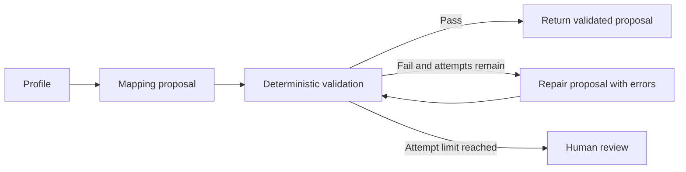

# Phase 3: constrained schema mapping

The graph profiles raw source rows, proposes a structured MappingPlan, validates it against every row and either returns a validated proposal or escalates to review. A mapping is not an engineering approval; later reconciliation and compatibility checks still apply.

## Profiles and proposals

Profiles report source types, missing/null counts, up to three detached example values, gram/kilogram suffix hints and target entity hints for known relationship fields. Examples are a proposal aid, not a substitute for full-row validation. Unit hints are restricted conventions (`_g` and `_kg`), not inferred measurements. Relationship hints describe expected identifier references; they do not certify their existence.

MappingPlan contains entity, field mappings and unsupported assumptions. Each field mapping records source, target, constrained transformation, optional enum dictionary, evidence and uncalibrated confidence. The LLM prompt contains the profile, target JSON schema, transformation contract and previous validation errors. It contains no evaluation truth or fault labels. Source values are explicitly treated as untrusted data.

OfflineMapper uses the versioned legacy dictionary. LLMMapper uses an explicitly configured model and optional OpenAI-compatible endpoint, structured Pydantic output, a 45-second request timeout and one transport retry. The live provider was not called in this checkpoint; constructor/prompt behavior was tested with a fake client.

## Executable contract

| Transformation | Executable constraint |
|---|---|
| identity | Copy the value without modifying the source |
| grams_to_kg | Numeric gram value (not a Boolean) from a documented gram-suffix field to `mass_kg` |
| strip | String source only; trim whitespace |
| lower | String source only; lowercase |
| enum | String source, explicit nonempty dictionary, no fallback for unseen values |

Validation requires all source fields to be accounted for, existing target fields, required target coverage, unique source and target assignments, nonblank evidence, compatible units and successful target-model validation for every row. Unknown source annotations require a reviewed schema change; they cannot silently disappear. Enum dictionaries on non-enum transformations are rejected. Assumptions force human review. Confidence does not bypass any rule.

No arbitrary code transformation exists. The target Pydantic schema supplies documented defaults; mapping validation prevents a present source field from being dropped to conceal its value behind a default. Target-model parsing still supports its normal domain conversions, such as ISO date strings. Deterministic engineering and source-reconciliation checks remain necessary after mapping validation.

## State and review

The state preserves entity, raw rows, profile, proposal, attempt count, errors, status and per-attempt history. Providers receive detached profile/error copies. Transformed nested values are also detached from source values. A provider cannot erase earlier failure evidence by mutating its arguments.

Malformed provider responses are parsed through MappingPlan inside the bounded proposal node. Provider exceptions retain the exception class, without copying private exception messages into state. A failed attempt cannot leave an old plan marked valid. Valid dictionary responses are parsed into the same schema as Pydantic responses.

There are three attempts by default; configuration accepts only integer limits from one through five. Each initial or repair proposal consumes an attempt. Exhaustion reaches terminal `review`; it does not approve the mapping or continue retrying. Invalid graph requests, including unknown entities or empty record sets, fail before a provider call. Human review decisions are persisted through the existing service/API; their integration will be reviewed in Phase 4.

## Checkpoint evidence

`python -m pytest tests/unit/test_mapping_workflow.py -q --junitxml=benchmarks/phase3-tests.xml` passes 48 checks. These cover both schemas across all six entities, full-row validation, unknown/omitted fields, conversion restrictions, malformed responses, transient recovery, retry bounds, assumptions, provider exception redaction, state isolation and the mocked live-provider prompt boundary. Full regression: 171 passed and one real-MongoDB check skipped. Pipeline version 1.2 prevents the stricter contract from reusing cached results produced by earlier pipeline versions.
